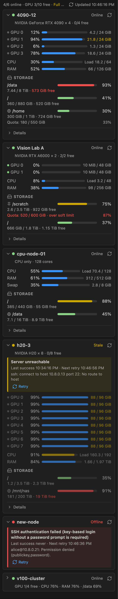

# ServerLens

在 VS Code 侧边栏里同时查看多台远程服务器的 GPU、CPU、内存、磁盘和个人配额。面向在多台共享 GPU 服务器上做实验的科研人员。

ServerLens 只通过 SSH 执行只读命令，不需要在服务器上安装 Agent、数据库或监控服务，也不需要 root 权限。



> 截图说明：图片是插件真实的侧边栏 HTML/CSS/JS 加载示例数据后，用 VS Code 默认主题的颜色变量在 Chrome 中渲染的结果，不是 VS Code 窗口截图。

## 功能

### 服务器卡片（侧边栏 Monitor 视图）

每台服务器一张卡片，从上到下依次是：

1. 服务器名称和连接状态：绿色在线、黄色数据过期（连接失败，显示最后一次数据）、红色离线、蓝色连接中。
2. GPU：每张卡的利用率和显存，左侧圆点表示该卡是否满足空闲规则。
3. CPU 使用率和负载、内存占用；Swap 使用超过 10% 时显示 Swap。
4. 存储：每个挂载点一行，进度条低于 70% 为绿色，70% 到 90% 为黄色，达到 90% 为红色（阈值可改）。
5. 详细信息：GPU 进程、CPU 型号和核心数、内存明细、系统信息、各项数据的更新时间、目录容量分析。

点击卡片标题可以折叠，折叠后只显示一行摘要。鼠标悬停在任意一行上可以看到完整数据（例如 GPU 温度和功耗、挂载点的设备和文件系统类型）。右键卡片或磁盘可以刷新单台服务器、连接 Remote-SSH、分析目录、静音该磁盘的提醒。

连接失败时，卡片会显示具体原因（例如“SSH 认证失败”“服务器不可达”）、ssh 的原始报错、最后一次成功更新的时间和下次自动重试的时间。

### 磁盘监控

- 自动识别有效挂载点：根目录、`/home`、`/data`、`/mnt/*`、NFS、Lustre、sshfs、CIFS 等都会显示，`tmpfs`、`overlay`、`squashfs`、`/proc`、`/run`、`/snap/*` 等系统挂载默认隐藏。
- 同一个文件系统有多个挂载点时（bind mount、btrfs 子卷、同一个 NFS 导出挂载多次）只显示一次，其余挂载点在悬停提示里列出。
- 固定显示的路径（`serverlens.pinnedMounts`）总是排在最前面。填写的路径不是挂载点时，会显示它所在的文件系统，例如 `~/projects` 在根分区上就显示根分区。
- 个人配额与磁盘剩余空间分开显示：服务器上有 `quota` 命令时读取 `quota -v`，有 Lustre 挂载时读取 `lfs quota`。超过软限制时配额行变红。
- 网络存储无响应时 `df` 会卡住。ServerLens 会在超时后改为只读取本地文件系统，并在卡片里提示“df 超时，仅显示本地文件系统”。
- 容量提醒：磁盘达到严重阈值时弹出一次通知，可以选择“稍后提醒（24 小时）”或“静音此磁盘”。使用率降到阈值以下 2 个百分点后才会再次提醒，重启 VS Code 也不会重复提醒同一次越线。

### CPU 和内存

- CPU 使用率由相邻两次 `/proc/stat` 采样计算，悬停可看到用户态、内核态、IO 等待和被抢占（steal）的占比。第一次采集时在服务器上间隔 0.5 秒读两次，不需要等下一轮。
- 显示逻辑核数、物理核数，以及当前 SSH 会话可用的核数（容器或 cgroup 限制时会更少）和 1/5/15 分钟负载。
- 内存使用 `/proc/meminfo` 的 `MemAvailable`，页缓存不算作已用。老内核没有 `MemAvailable` 时用 `MemFree + Buffers + Cached + SReclaimable - Shmem` 估算，并标注“估算值”。

### GPU（沿用 GPU Fleet Viewer）

型号、利用率、显存、温度、功耗、风扇、计算进程（用户、PID、显存、运行时间、命令）、Slurm 作业、空闲 GPU 判定和“查找空闲 GPU”。没有 `nvidia-smi` 的服务器显示为“仅 CPU”，CPU、内存和磁盘照常显示。

### 目录容量分析

在卡片详细信息里点“分析目录占用…”，或运行命令 **ServerLens: Analyze Storage…**。可选：

- Home 目录、Conda 环境与包缓存、pip 缓存、Hugging Face 缓存、PyTorch 缓存、整个 `~/.cache`；
- `serverlens.storagePaths` 里配置的目录（项目、数据集、Checkpoints、训练日志等）；
- 手动输入的路径。

扫描用 `du -x -k -d <深度>`，以 `nice -n 19` 和 `ionice -c3`（服务器上有时）的低优先级运行，并受 `timeout` 限制。同一台服务器同一时间只能有一个扫描，可以随时取消，取消时会结束服务器上的 `du` 进程。结果按占用从大到小排列。扫描只能由你手动触发，只读，不提供删除功能。

### 仪表盘和 Servers 树（原有功能）

- 仪表盘（编辑器标签页）保留 GPU Fleet Viewer 的全部功能：筛选、排序、进程检查器、收藏和分组、打开 GPU 终端、复制 `CUDA_VISIBLE_DEVICES`、设置对话框。服务器行新增 CPU、内存和最满的磁盘。
- Servers 树保留原来的 Dashboard 入口、服务器列表和行内的 Connect 按钮，每台服务器后面显示状态，例如 `3/8 GPU free · /data 93%`。
- 状态栏显示空闲 GPU 数和将满磁盘数，点击打开侧边栏。

## 安装

1. 下载 `serverlens-0.1.0.vsix`（仓库的 `releases/` 目录或自行打包）。
2. 在 VS Code 中打开扩展视图，点击右上角 `…` → **从 VSIX 安装…**，选择该文件。也可以在终端运行：

   ```sh
   code --install-extension serverlens-0.1.0.vsix
   ```

3. 点击活动栏中的 ServerLens 图标。

ServerLens 与 GPU Server Viewer、GPU Fleet Viewer 使用不同的扩展 ID 和设置前缀，可以同时安装。首次启动时会把 `gpu-fleet-viewer.*`（或 `gpu-server-viewer.*`）中的同名设置复制一次。

### 前提条件

- 本机有 OpenSSH 客户端（`ssh` 在 PATH 中）。
- 能用密钥免密登录服务器（ServerLens 使用 `BatchMode=yes`，不会弹出密码输入）。可以先在终端执行一次 `ssh <host>`，确认主机密钥已受信任。
- 服务器是 Linux，有 `/bin/sh` 和常见命令（`awk`、`df`、`ps`）。`nvidia-smi`、`timeout`、`quota`、`lfs`、`ionice` 有则使用，没有也能工作。
- “连接”按钮需要安装微软的 Remote - SSH 扩展。

## 选择要监控的服务器

默认监控 `~/.ssh/config` 中所有不含通配符的 `Host`。服务器较多时建议只选常用的几台：

- 侧边栏标题栏 `…` → **Choose Servers**，勾选要显示的服务器；
- 或设置 `serverlens.targets`（只监控这些别名）、`serverlens.ignoredHosts`（排除）、`serverlens.additionalHosts`（不在 SSH config 里的 `user@host`）。

超过 6 台服务器时，卡片默认折叠，只显示一行摘要。

## 设置

所有设置都在 VS Code 设置的 `serverlens.*` 下，仪表盘的“设置”对话框也能修改大部分设置。

| 设置 | 默认值 | 说明 |
|---|---|---|
| `serverlens.sshConfigPath` | `~/.ssh/config` | SSH 配置文件 |
| `serverlens.targets` / `ignoredHosts` / `additionalHosts` | 空 | 监控哪些服务器（见上一节） |
| `serverlens.refreshInterval` | `5` | GPU 刷新间隔（秒） |
| `serverlens.cpuRefreshInterval` | `5` | CPU 刷新间隔（秒） |
| `serverlens.memoryRefreshInterval` | `5` | 内存刷新间隔（秒） |
| `serverlens.diskRefreshInterval` | `60` | 磁盘和配额刷新间隔（秒） |
| `serverlens.autoRefresh` | `true` | 关闭后只在手动刷新时采集 |
| `serverlens.pauseWhenHidden` | `true` | 侧边栏和仪表盘都不可见时暂停自动刷新 |
| `serverlens.sshTimeout` | `8` | SSH 连接超时（秒）；每条远程命令也受此时间限制 |
| `serverlens.maxConcurrentHosts` | `8` | 同时采集的服务器数 |
| `serverlens.connectionReuse` | `true` | 每台服务器复用一个 SSH 连接（Windows 不支持，会自动关闭） |
| `serverlens.connectionIdleSeconds` | `120` | 复用的连接空闲多久后关闭（秒） |
| `serverlens.diskWarningThreshold` | `70` | 磁盘黄色阈值（%） |
| `serverlens.diskCriticalThreshold` | `90` | 磁盘红色阈值（%），也是容量提醒阈值 |
| `serverlens.diskAlerts` | `critical` | `off` 关闭；`critical` 达到红色阈值时提醒；`warning` 达到黄色和红色阈值时都提醒 |
| `serverlens.pinnedMounts` | 空 | 固定显示的路径，如 `/data`、`~/projects`；`gpu-01:/scratch` 只对 gpu-01 生效 |
| `serverlens.hiddenMounts` | 空 | 额外隐藏的挂载点模式，如 `/mnt/backup*` |
| `serverlens.hiddenFilesystemTypes` | 空 | 额外隐藏的文件系统类型，如 `fuse.*` |
| `serverlens.showAllFilesystems` | `false` | 连 tmpfs、overlay 等系统文件系统也显示 |
| `serverlens.showQuota` | `true` | 读取个人磁盘配额 |
| `serverlens.byteUnits` | `iec` | `iec`：KiB/MiB/GiB/TiB（1024 进制，与 `df -h`、`nvidia-smi` 一致）；`si`：kB/MB/GB/TB（1000 进制） |
| `serverlens.storagePaths` | 空 | 目录分析的常用目录，写成 `路径` 或 `名称=路径`，如 `Checkpoints=/data/alice/ckpt` |
| `serverlens.storageScanDepth` | `2` | 目录分析深度（1 到 4 层） |
| `serverlens.storageScanTimeout` | `60` | 单次目录分析的时间上限（秒） |
| `serverlens.showProcesses` | `true` | 采集并显示 GPU 进程（需要在服务器上运行 `ps`） |
| `serverlens.enableSlurmIntegration` | `true` | 把 GPU 进程关联到 Slurm 作业 |
| `serverlens.availabilityRequireNoProcesses` 等 | 见设置 | GPU 空闲判定规则 |
| `serverlens.enableNotifications` | `false` | GPU 释放、服务器上下线、GPU 阈值通知 |
| `serverlens.showStatusBar` | `true` | 状态栏摘要 |
| `serverlens.language` | `auto` | 界面语言：跟随 VS Code、English、简体中文 |

## 在服务器上执行了什么

每一轮采集只开一个 SSH 会话，把下面这些命令合成一个 POSIX sh 脚本，通过标准输入交给 `sh -s` 执行（与登录 shell 是 bash、zsh 还是 fish 无关）：

| 数据 | 命令 | 默认频率 |
|---|---|---|
| GPU | `nvidia-smi --query-gpu=…`、`nvidia-smi --query-compute-apps=…`、`ps -o … -p <GPU 进程>` | 5 秒 |
| Slurm（可选） | `scontrol listpids`、`squeue -h` | 30 秒 |
| CPU | 读取 `/proc/stat`、`/proc/loadavg`，`nproc` | 5 秒 |
| 内存 | 读取 `/proc/meminfo` | 5 秒 |
| 磁盘 | `df -P -k -T`（固定路径另用 `df <路径>`）、`quota -v`、`lfs quota` | 60 秒 |
| 系统信息 | `uname`、`id -un`、`/etc/os-release`、`/proc/uptime`、`/proc/cpuinfo` | 随磁盘 |
| 目录分析 | `du -x -k -d N`（低优先级，有时间上限） | 仅手动 |

到期时间相近的指标合并到同一次 SSH 执行；同一台服务器上一轮没结束时不会开始下一轮。每条命令在服务器上有 `timeout` 时都会被限时；一轮采集耗时很长的服务器会自动降低采集频率。

## 资源占用与安全

- 连接复用：使用 OpenSSH 的 ControlMaster，每台服务器只保持一个 TCP 连接，后续采集复用它，空闲 `connectionIdleSeconds` 秒后自动断开。控制套接字放在 `/tmp/serverlens-<uid>/`，目录权限 0700，使用前检查属主和类型。停用插件或关闭 VS Code 时，ServerLens 会关闭它打开的所有共享连接。
- 监控连接会清除 SSH config 里的端口转发（`ClearAllForwardings=yes`），并关闭 agent 和 X11 转发，不会占用你在 config 里为交互会话配置的 `RemoteForward` 端口。
- ServerLens 从不读取或保存密码、私钥。它只调用系统的 `ssh`，认证完全交给 ssh 和 ssh-agent。日志（输出面板 “ServerLens”）只记录主机别名、耗时和错误类型；ssh 的报错在显示前会去掉私钥块和控制字符。
- 采集失败的服务器按 10 秒、20 秒、40 秒……最长 2 分钟的间隔退避重试，手动刷新会立即重试。
- 侧边栏和仪表盘都不可见时自动暂停采集（`pauseWhenHidden`）。

## 常见问题

| 现象 | 原因和处理 |
|---|---|
| SSH 认证失败 | ServerLens 不能输入密码。配置密钥登录，并确认 ssh-agent 已加载密钥 |
| 主机密钥未受信任 | 在终端执行一次 `ssh <host>` 并确认指纹 |
| GPU 显示 “nvidia-smi did not respond in time” | 服务器上 `nvidia-smi` 很慢（驱动未开启持久模式，或很多程序同时查询）。下一轮会自动放宽到 45 秒；也可以请管理员开启 `nvidia-smi -pm 1` |
| “df 超时，仅显示本地文件系统” | 某个网络挂载（NFS 等）无响应。本地盘照常显示，网络盘恢复后会自动出现 |
| 磁盘太多 | 用 `serverlens.hiddenMounts` 隐藏不关心的挂载点，或用 `serverlens.pinnedMounts` 固定重要的路径 |
| Windows 上没有连接复用 | Windows 自带的 OpenSSH 不支持 ControlMaster，每轮会新建连接 |

## 已知限制

- 只支持 Linux 服务器和 NVIDIA GPU（通过 `nvidia-smi`）。
- 配额只支持 `quota`（ext4/xfs/NFS rquotad）和 Lustre 的 `lfs quota`；XFS 项目配额、BeeGFS、GPFS 的配额工具暂不支持。
- 同一台物理机配置了多个别名时，GPU 只在汇总中计算一次，但每个别名都会被采集。
- 目录分析只读，不提供删除或清理。

## 开发

见 [DEVELOPMENT.md](DEVELOPMENT.md)。测试结果见 [docs/TEST_REPORT.md](docs/TEST_REPORT.md)，与原插件相比的改动见 [CHANGELOG.md](CHANGELOG.md)。

## 许可与致谢

ServerLens 以 Apache License 2.0 发布。它基于 [GPU Fleet Viewer](https://github.com/yruichen/gpu-fleet-viewer)（Copyright 2026 yruichen），后者基于 [GPU Server Viewer](https://github.com/Riku-0801/gpu-server-viewer)（Riku-0801），两者均为 Apache-2.0。署名和修改说明见 [NOTICE](NOTICE) 与 [LICENSE.txt](LICENSE.txt)。图标中的线条图标来自 [Lucide](https://lucide.dev/)（ISC，见 `resources/LUCIDE-LICENSE`）。
